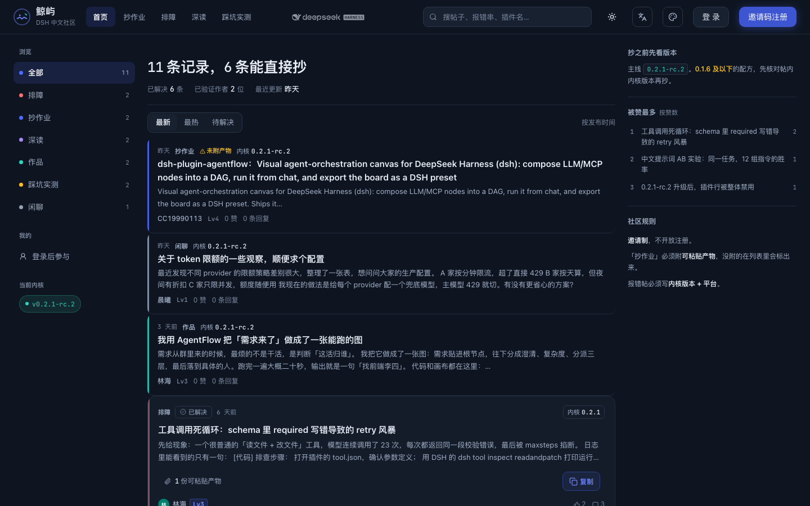
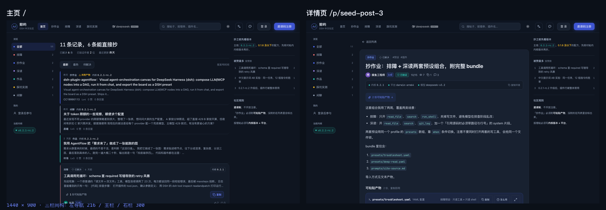
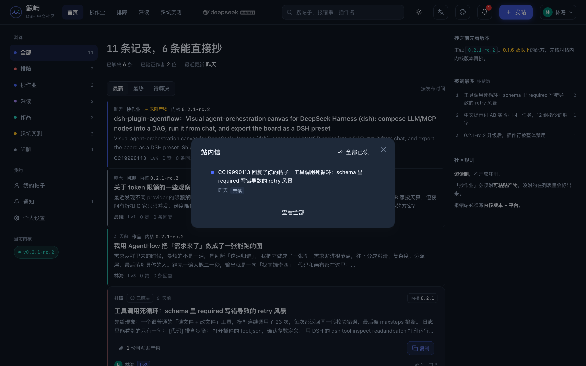
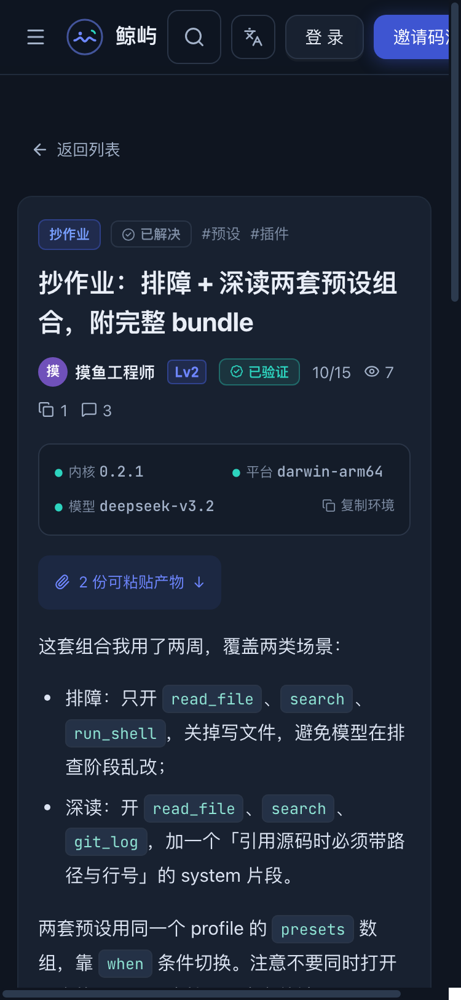

# 鲸屿 · DSH 中文社区

> 一个「能直接抄」的技术社区：每条记录都带可粘贴的产物、内核版本与平台。

**线上：<https://jingyu.run>**

---

## 为什么做这个

技术社区里最没用的东西，是「我成功了」这四个字。

真正有价值的记录长这样：一句现象、一段可粘贴的产物、一个明确的版本号。读者拿到就能跑，跑不通也知道是谁的环境不对。但这类内容在聊天窗口里活不过三天，在知乎里会被排版吃掉，在 GitHub Issue 里又找不到同类。

所以鲸屿把「**产物**」做成了一等公民：

- 帖子可以带 patch / preset bundle / 画布 json / shell 脚本，最多 5 份
- 列表里就给出首份产物全文，**点一下直接进剪贴板，零次额外请求**
- 每篇必须标注内核版本 / 平台 / 模型 —— 不给环境的教程等于没写
- 审核通过才算「已验证」，被采纳的答案会被标记，帖子自动转「已解决」

## 截图

| 主页（列表即入口） | 详情（主页同款三栏） |
| --- | --- |
|  |  |

| 站内信（顶栏铃铛弹窗） | 移动端（首屏直接复制） |
| --- | --- |
|  |  |

## 几个当时想清楚的设计决定

**1. 列表有两种形状，不是一种**
要行动的（排障未解决、带产物）是卡片，带复制按钮；纯阅读与已归档的是平铺索引行，密度更高。同一个信息流里混两种形状，比全部做成卡片省一半滚动。

**2. 「复制产物」是 0 请求的**
首份产物全文随列表一起下发（≤4096 字符，**绝不截断**）。超限时明确告诉用户「进帖复制」，而不是给半截 patch —— 复制出去跑不通的 patch 比复制不了更糟。

**3. 断点按行为拆，不按设备拆**
1180 / 1080 / 767 / 640 / 480 各自负责一件事。原来用 860 一个断点同时管「藏主导航」和「藏右栏」，结果 861px 宽时搜索框宽度算成 0px。

**4. 去 AI 味不是换个配色**
验收标准是两条：连续读 10 条内容会不会视觉疲劳；截屏给朋友能不能猜出是什么品牌。具体做法见 [设计规范](./docs/design-system.md) 与 [AI 味自检清单](./docs/ai-smell-checklist.md)。

## 技术栈

| 层 | 选型 |
| --- | --- |
| 前端 | React 19 · Vite 8 · TypeScript · Tailwind CSS 4 · antd 6 · TanStack Query |
| 后端 | NestJS · Prisma · PostgreSQL 17 · Redis |
| 认证 | GitHub / Google OAuth · 邀请制 · ed25519 设备徽章 · 信任等级 |
| 部署 | 单机 Docker Compose · Caddy（自动 TLS + 按 UA 分流爬虫） |

更多：[架构](./docs/architecture.md) · [产品需求](./docs/PRD.md) · [设计规范](./docs/design-system.md) · [接口契约](./docs/api.md)

## 工程上值得一提的

- **152 条单元测试**，零 DB / Redis 依赖，任何机器 `pnpm test` 即跑（审核状态机 / 权限守卫 / 邀请码 / 限流 / 校验）
- **主 chunk 从 1.26MB 拆到 109KB**：路由级懒加载 + manualChunks（antd 单独成块，升级不炸整包缓存）
- **分享卡片与收录**：爬虫命中 UA 时由 Caddy 改写到服务端渲染的分享页（正文 + OpenGraph + JSON-LD），IndexNow 主动推送
- **数据库备份**：pg_dump -Fc 保留 7 份 + sha256 校验 + 恢复演练脚本（恢复到临时库比对三表条数）

## 许可

本仓库仅用于展示，内容（文档与截图）版权归作者所有，未经许可请勿转载。站点代码本身为私有仓库。
